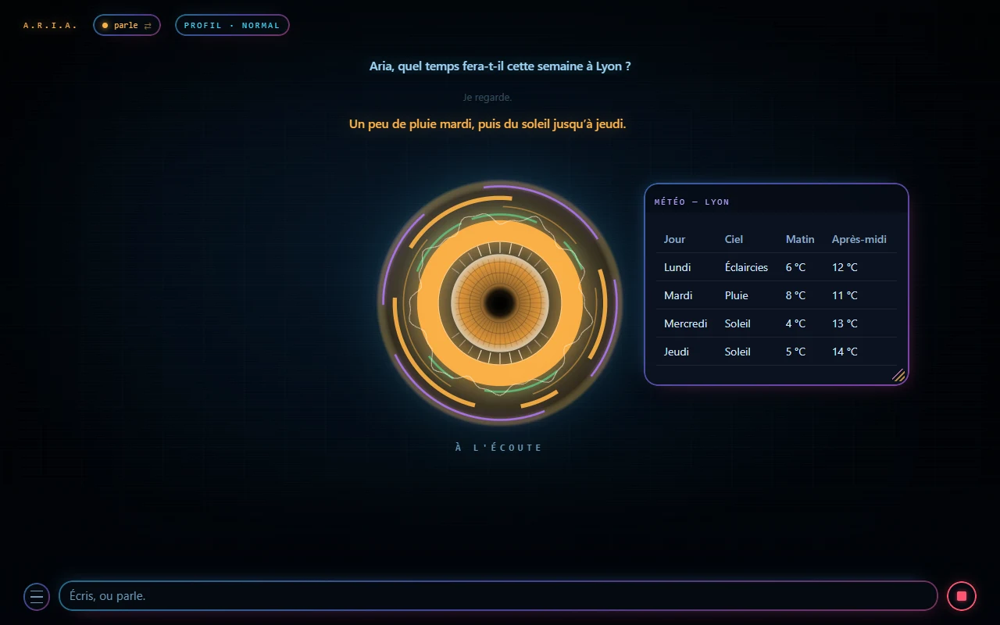
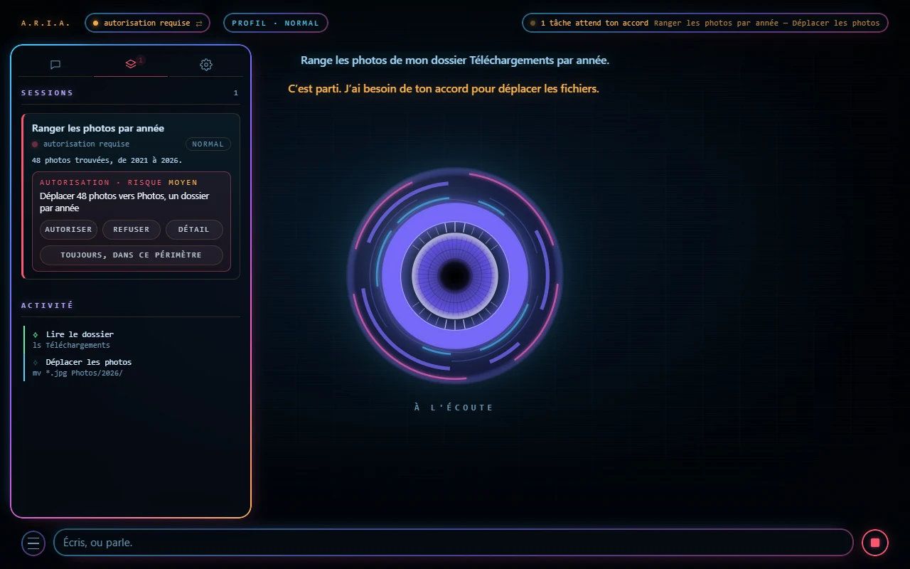
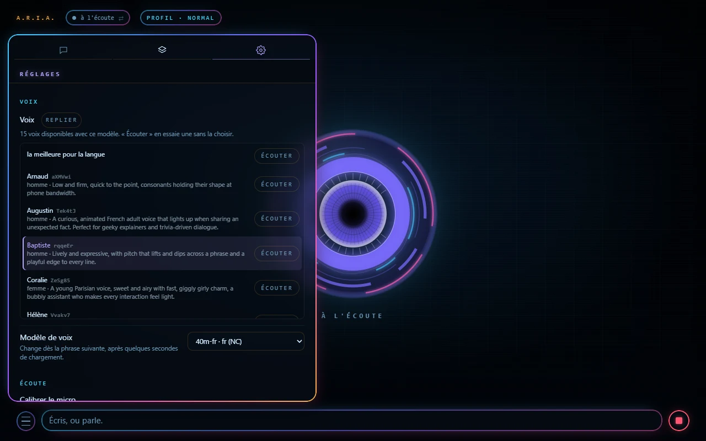

# ARIA

[Français](docs/readme/README-FR.md)

A voice assistant that runs on your machine. You speak, it answers aloud, and it hands the real work to agent
sessions that you can see and authorise.

| | Today | Planned |
|---|---|---|
| **Language** | French | [English, then others](docs/todos/other-languages.md) |
| **Agent** | Claude Code | [the agent CLI you choose](docs/todos/other-engines.md): opencode, Gemini, Mistral Vibe, Codex |
| **System** | Windows | [Linux](docs/todos/linux.md) |



## Install

For now you need Windows x64, a processor from 2013 or later (Intel Haswell, AMD Zen), a microphone, about 6 GB of
disk and a Claude account that can use Claude Code.

1. **Install [Claude Code](https://claude.com/claude-code)**, then run `claude` once in a terminal to sign in.
2. **Download and run [the latest ARIA installer](https://github.com/Coopaguard/ARIA/releases/latest).** It is
   not signed yet, so Windows announces an unknown publisher: *More info*, then *Run anyway*.
3. **Follow the first-start screen.** It checks Claude Code, downloads the models (about 3.8 GB, and 1.3 GB more
   with an NVIDIA card), sets the voice and calibrates the microphone. The French voices need no account.

ARIA then offers its own updates.

## Use

| To | Do |
|---|---|
| **Ask something** | Say "Aria" and your request, or type it at the bottom |
| **Interrupt** | Speak over it |
| **Put it to sleep** | "Merci Aria", "chut", "mets-toi en veille" |
| **Show or hide the window** | `Ctrl`+`Alt`+`C`, from anywhere. Closing the window leaves ARIA by the clock |
| **Close the microphone** | Click the orb. Running tasks go on |
| **Stop everything** | The red square: microphone and tasks |

Two buttons at the top decide what ARIA may hear and do:

- **Listening** — *nommé seulement*: nothing leaves the machine until its name is recognised. *À l'écoute*: it
  answers everything, and goes back to its name after two minutes without an exchange.
- **Profile** — what a task may do without asking: *plan* (reads only), *strict*, *normal*, *autonome*.

What ARIA does not answer itself becomes a task, shown in the menu. When one needs your agreement, a card waits
there until you answer:

| A task asks for permission | Choose a voice |
|---|---|
|  |  |

ARIA can also show tables, forms, PDF, audio and video, remember what you tell it, and resume a conversation.
Fifteen French voices are ready to use; 87 others come with the multilingual model, which needs a Hugging Face
account. Everything else is in the settings, in the left-hand menu.

**Your data.** Your voice is transcribed on your machine; the text goes to Claude, unless you choose a local
model. Your memories, history and logs are in `~/.aria`, yours to open; the models are in `%LOCALAPPDATA%\aria`.

**Before you trust it.** ARIA runs real agents on your machine. An unrecognised action asks first, "always" is
never offered for high risk, every decision is recorded, and tiles are isolated. There are **no** forbidden
folders, no dry run and no bin yet: see [what is missing](docs/todos/security-guards.md).

## Work on the project

You need Rust, Node.js and the Visual Studio C++ build tools.

```bash
npm install                 # once: the Tauri CLI
npm --prefix ui install     # once: Vue, Vite, types
npm run dev                 # the application, with its development server
cargo test -p aria-core     # the fast tests, no window and no model
npm --prefix ui run check   # front-end types
```

| Where | What |
|---|---|
| `app/` | the Tauri application: configuration, windows, IPC, voice |
| `crates/core/` | everything that runs without a window |
| `crates/voice/` | the ear and the voice |
| `crates/memory/` | the embedder of the memory |
| `ui/` | the front end, Vue 3 and TypeScript |

Contributions go to `develop` by pull request, and the CI must pass.

- [AGENTS.md](AGENTS.md): all the commands, the decisions already made, how to release
- [Roadmap](docs/ROADMAP.md): what is left to do, one page per task
- [docs/cli/](docs/cli/): what each agent CLI can do

## Licence

[PolyForm Noncommercial 1.0.0](LICENSE): use, change and share it, with its notice, **never for commercial purposes**.

ARIA stands on **Phonon** and `ptts` by **Gradium**, the **xn** inference engine by Laurent Mazare,
**Kyutai TTS** (Pocket TTS) by Kyutai, and **Parakeet** by NVIDIA. The full list is in
[THIRD-PARTY-NOTICES.md](THIRD-PARTY-NOTICES.md).
