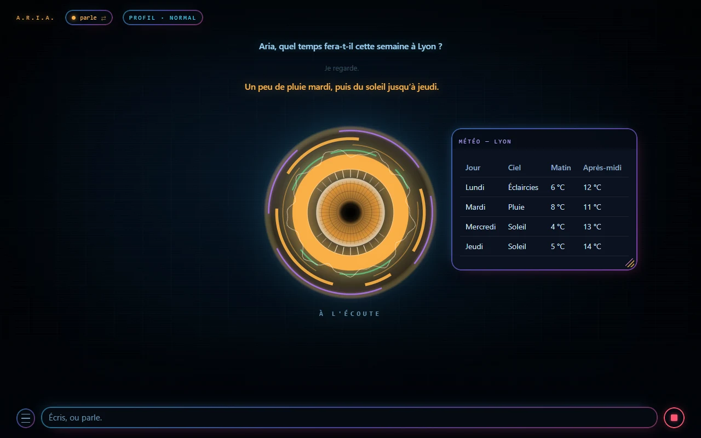
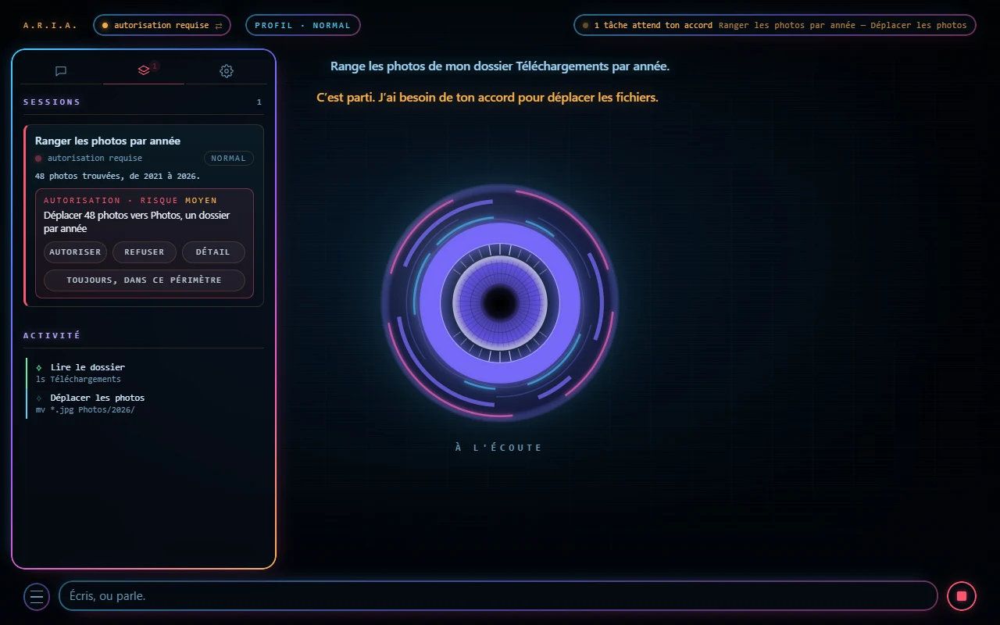
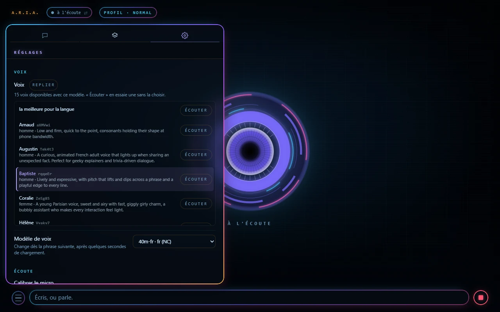

# ARIA

[English](../../README.md)

Un assistant vocal qui tourne sur votre machine. Vous parlez, il répond à voix haute, et il confie le vrai travail
à des sessions d'agent que vous voyez et que vous autorisez.

| | Aujourd'hui | Prévu |
|---|---|---|
| **Langue** | français | [anglais, puis d'autres](../todos/other-languages.md) |
| **Agent** | Claude Code | [la CLI d'agent de votre choix](../todos/other-engines.md) : opencode, Gemini, Mistral Vibe, Codex |
| **Système** | Windows | [Linux](../todos/linux.md) |



## Installer

Pour le moment, il faut Windows x64, un processeur de 2013 ou plus récent (Intel Haswell, AMD Zen), un micro, environ 6 Go de
disque et un compte Claude qui donne accès à Claude Code.

1. **Installez [Claude Code](https://claude.com/claude-code)**, puis lancez `claude` une fois dans un terminal
   pour vous connecter.
2. **Téléchargez et lancez [le dernier installeur d'ARIA](https://github.com/Coopaguard/ARIA/releases/latest).**
   Il n'est pas encore signé, donc Windows annonce un éditeur inconnu : *Informations complémentaires*, puis
   *Exécuter quand même*.
3. **Suivez l'écran de premier démarrage.** Il vérifie Claude Code, télécharge les modèles (environ 3,8 Go, et 1,3 Go
   de plus avec une carte NVIDIA), règle la voix et calibre le micro. Les voix françaises ne demandent aucun compte.

ARIA propose ensuite elle-même ses mises à jour.

## Utiliser

| Pour | Faites |
|---|---|
| **Demander quelque chose** | Dites « Aria » et votre demande, ou écrivez-la en bas |
| **L'interrompre** | Parlez par-dessus |
| **La mettre en veille** | « Merci Aria », « chut », « mets-toi en veille » |
| **Afficher ou cacher la fenêtre** | `Ctrl`+`Alt`+`C`, depuis n'importe où. Fermer la fenêtre laisse ARIA près de l'horloge |
| **Couper le micro** | Cliquez sur l'orbe. Les tâches en cours continuent |
| **Tout arrêter** | Le carré rouge : le micro et les tâches |

Deux boutons, en haut, décident de ce qu'ARIA peut entendre et faire :

- **L'écoute** — *nommé seulement* : rien ne sort de la machine tant que son nom n'est pas reconnu. *À l'écoute* :
  elle répond à tout, et revient à son nom après deux minutes sans échange.
- **Le profil** — ce qu'une tâche peut faire sans demander : *plan* (lecture seule), *strict*, *normal*, *autonome*.

Ce à quoi ARIA ne répond pas seule devient une tâche, visible dans le menu. Quand l'une d'elles a besoin de votre
accord, une carte y attend votre réponse :

| Une tâche demande l'autorisation | Choisir une voix |
|---|---|
|  |  |

ARIA sait aussi afficher des tableaux, des formulaires, des PDF, de l'audio et de la vidéo, se souvenir de ce que
vous lui dites et reprendre une conversation. Quinze voix françaises sont prêtes ; 87 autres viennent avec le
modèle multilingue, qui demande un compte Hugging Face. Le reste est dans les réglages, menu de gauche.

**Vos données.** Votre voix est transcrite sur votre machine ; le texte part chez Claude, sauf avec un modèle
local. Vos souvenirs, l'historique et les journaux sont dans `~/.aria`, que vous pouvez ouvrir ; les modèles sont
dans `%LOCALAPPDATA%\aria`.

**Avant de lui faire confiance.** ARIA lance de vrais agents sur votre machine. Une action non reconnue demande
d'abord, « toujours » n'est jamais proposé pour un risque élevé, chaque décision est consignée, et les tuiles sont
isolées. Il n'y a **pas** encore de dossiers interdits, de simulation ni de corbeille : voir
[ce qui manque](../todos/security-guards.md).

## Travailler sur le projet

Il faut Rust, Node.js et les outils de compilation C++ de Visual Studio.

```bash
npm install                 # une fois : le CLI Tauri
npm --prefix ui install     # une fois : Vue, Vite, le typage
npm run dev                 # l'application, avec son serveur de développement
cargo test -p aria-core     # les tests rapides, sans fenêtre ni modèle
npm --prefix ui run check   # le typage du front
```

| Où | Quoi |
|---|---|
| `app/` | l'application Tauri : configuration, fenêtres, IPC, voix |
| `crates/core/` | tout ce qui tourne sans fenêtre |
| `crates/voice/` | l'oreille et la voix |
| `crates/memory/` | le vectoriseur de la mémoire |
| `ui/` | le front, Vue 3 et TypeScript |

Les contributions arrivent sur `develop` par pull request, et la CI doit passer.

- [AGENTS.md](../../AGENTS.md) : toutes les commandes, les décisions prises, la publication
- [Feuille de route](../ROADMAP.md) : ce qui reste à faire, une fiche par tâche
- [docs/cli/](../cli/) : ce que sait faire chaque CLI d'agent

## Licence

[PolyForm Noncommercial 1.0.0](../../LICENSE) : utiliser, modifier et partager, avec sa mention, **jamais à des fins commerciales**.

ARIA repose sur **Phonon** et `ptts` de **Gradium**, le moteur d'inférence **xn** de Laurent Mazare,
**Kyutai TTS** (Pocket TTS) de Kyutai, et **Parakeet** de NVIDIA. La liste complète est dans
[THIRD-PARTY-NOTICES.md](../../THIRD-PARTY-NOTICES.md).
